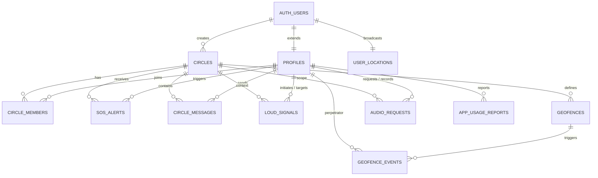

# 📚 Kamus & Library Database LingkarAman (Supabase PostgreSQL)

Dokumen ini berisi dokumentasi lengkap seluruh struktur tabel, tipe data, relasi antar tabel (ERD), fungsi keamanan (RLS), stored procedures, dan konfigurasi Realtime untuk aplikasi **LingkarAman**.

File SQL DDL lengkap siap pakai tersimpan di: [`migration_full.sql`](file:///g:/AI%20APP/aplikasi%20circle/migration_full.sql).

---

## 🗺️ Diagram Relasi Tabel (Entity-Relationship Diagram)

---

## 🗄️ Rincian 11 Tabel Database

### 1. `profiles`
Menyimpan data identitas pengguna publik yang ditautkan ke akun `auth.users` Supabase.
* **Primary Key:** `id` (UUID, FK `auth.users(id) ON DELETE CASCADE`)

| Nama Kolom | Tipe Data | Nullable | Default | Keterangan |
| :--- | :--- | :--- | :--- | :--- |
| `id` | `UUID` | No | - | ID user (merujuk ke Auth Supabase) |
| `full_name` | `TEXT` | No | - | Nama lengkap / tampilan pengguna |
| `phone_number` | `TEXT` | Yes | `NULL` | Nomor HP aktif pengguna |
| `avatar_url` | `TEXT` | Yes | `NULL` | URL foto profil pengguna |
| `emergency_contact_phone` | `TEXT` | Yes | `NULL` | Nomor darurat cadangan |
| `created_at` | `TIMESTAMPTZ` | Yes | `NOW()` | Waktu pembuatan akun |
| `updated_at` | `TIMESTAMPTZ` | Yes | `NOW()` | Waktu update terakhir |

---

### 2. `circles`
Menyimpan grup lingkaran keluarga / komunitas perlindungan.
* **Primary Key:** `id` (UUID, `gen_random_uuid()`)

| Nama Kolom | Tipe Data | Nullable | Default | Keterangan |
| :--- | :--- | :--- | :--- | :--- |
| `id` | `UUID` | No | `gen_random_uuid()` | ID unik lingkaran |
| `name` | `TEXT` | No | - | Nama grup (contoh: "Keluarga Cemara") |
| `invite_code` | `VARCHAR(8)`| No | - | **UNIQUE**, 6-8 digit kode join lingkaran |
| `created_by` | `UUID` | Yes | `NULL` | FK ke `auth.users(id)`, pembuat lingkaran |
| `created_at` | `TIMESTAMPTZ` | Yes | `NOW()` | Tanggal pembuatan |

---

### 3. `circle_members`
Menghubungkan profil pengguna ke lingkaran keluarga tertentu (Relasi Many-to-Many).
* **Primary Key:** `id` (UUID, `gen_random_uuid()`)
* **Constraint Unik:** `(circle_id, user_id)`

| Nama Kolom | Tipe Data | Nullable | Default | Keterangan |
| :--- | :--- | :--- | :--- | :--- |
| `id` | `UUID` | No | `gen_random_uuid()` | ID keanggotaan |
| `circle_id` | `UUID` | No | - | FK `circles(id) ON DELETE CASCADE` |
| `user_id` | `UUID` | No | - | FK `profiles(id) ON DELETE CASCADE` |
| `role` | `VARCHAR(20)`| No | `'member'` | Peran: `'admin'` atau `'member'` |
| `is_sharing_location` | `BOOLEAN` | No | `TRUE` | Saklar berbagi GPS ke lingkaran ini |
| `joined_at` | `TIMESTAMPTZ` | Yes | `NOW()` | Waktu saat pertama bergabung |

---

### 4. `user_locations` *(Realtime Active)*
Menyimpan koordinat GPS posisi terbaru dan indikator daya setiap pengguna.
* **Primary Key:** `user_id` (UUID, FK `auth.users(id) ON DELETE CASCADE`)

| Nama Kolom | Tipe Data | Nullable | Default | Keterangan |
| :--- | :--- | :--- | :--- | :--- |
| `user_id` | `UUID` | No | - | ID pengguna pemilik lokasi |
| `latitude` | `DOUBLE PRECISION`| No | - | Koordinat lintang (-90 s/d 90) |
| `longitude`| `DOUBLE PRECISION`| No | - | Koordinat bujur (-180 s/d 180) |
| `battery_level` | `INTEGER` | Yes | `100` | Sisa baterai dalam persen (0 - 100%) |
| `is_charging` | `BOOLEAN` | Yes | `FALSE` | Status apakah HP sedang dicas |
| `speed` | `DOUBLE PRECISION`| Yes | `0` | Kecepatan gerak (meter/detik atau km/jam) |
| `updated_at` | `TIMESTAMPTZ` | Yes | `NOW()` | Timestamp terakhir kali GPS mengirim update |

---

### 5. `sos_alerts` *(Realtime Active)*
Mencatat seluruh insiden darurat, tombol SOS, dan jebakan penyusup.
* **Primary Key:** `id` (UUID, `gen_random_uuid()`)

| Nama Kolom | Tipe Data | Nullable | Default | Keterangan |
| :--- | :--- | :--- | :--- | :--- |
| `id` | `UUID` | No | `gen_random_uuid()` | ID insiden darurat |
| `user_id` | `UUID` | No | - | FK `profiles(id)`, korban yang memicu SOS |
| `circle_id` | `UUID` | Yes | `NULL` | FK `circles(id)`, lingkaran yang dikirimi alarm |
| `latitude` | `DOUBLE PRECISION`| No | - | Titik lintang kejadian |
| `longitude`| `DOUBLE PRECISION`| No | - | Titik bujur kejadian |
| `message` | `TEXT` | Yes | `'DARURAT!'` | Pesan bahaya (termasuk tag `[JEBAKAN PENYUSUP]`) |
| `status` | `VARCHAR(20)`| No | `'active'` | Status: `'active'`, `'resolved'`, `'cancelled'` |
| `triggered_at` | `TIMESTAMPTZ` | Yes | `NOW()` | Waktu sinyal darurat dipicu |
| `resolved_at` | `TIMESTAMPTZ` | Yes | `NULL` | Waktu saat alarm dinonaktifkan/ditolong |

---

### 6. `circle_messages` *(Realtime Active)*
Kanal perpesanan dan komunikasi instan antar anggota dalam lingkaran.
* **Primary Key:** `id` (UUID, `gen_random_uuid()`)

| Nama Kolom | Tipe Data | Nullable | Default | Keterangan |
| :--- | :--- | :--- | :--- | :--- |
| `id` | `UUID` | No | `gen_random_uuid()` | ID pesan |
| `circle_id` | `UUID` | No | - | FK `circles(id) ON DELETE CASCADE` |
| `user_id` | `UUID` | No | - | FK `profiles(id)`, pengirim pesan |
| `message` | `TEXT` | No | - | Isi teks pesan |
| `created_at` | `TIMESTAMPTZ` | Yes | `NOW()` | Waktu pengiriman pesan |

---

### 7. `loud_signals` *(Realtime Active)*
Mekanisme membunyikan sirine darurat jarak jauh (Bypass Mode Hening / DND).
* **Primary Key:** `id` (UUID, `gen_random_uuid()`)

| Nama Kolom | Tipe Data | Nullable | Default | Keterangan |
| :--- | :--- | :--- | :--- | :--- |
| `id` | `UUID` | No | `gen_random_uuid()` | ID sinyal |
| `sender_id` | `UUID` | Yes | `NULL` | FK `profiles(id)`, yang meminta dering |
| `target_user_id` | `UUID` | Yes | `NULL` | FK `profiles(id)`, HP sasaran yang dibunyikan |
| `circle_id` | `UUID` | Yes | `NULL` | FK `circles(id)` |
| `status` | `TEXT` | No | `'pending'` | Status: `'pending'`, `'ringing'`, `'stopped'` |
| `created_at` | `TIMESTAMPTZ` | No | `now()` | Waktu pemicuan |
| `stopped_at` | `TIMESTAMPTZ` | Yes | `NULL` | Waktu dimatikan oleh pemilik HP |

---

### 8. `geofences`
Zona aman virtual (Pagar Gaib) yang dipasang oleh keluarga di peta.
* **Primary Key:** `id` (UUID, `gen_random_uuid()`)

| Nama Kolom | Tipe Data | Nullable | Default | Keterangan |
| :--- | :--- | :--- | :--- | :--- |
| `id` | `UUID` | No | `gen_random_uuid()` | ID zona aman |
| `circle_id` | `UUID` | Yes | `NULL` | FK `circles(id) ON DELETE CASCADE` |
| `name` | `TEXT` | No | - | Nama zona (contoh: "Rumah Nenek", "Sekolah") |
| `category` | `TEXT` | No | `'home'` | Kategori ikon: `'home'`, `'school'`, `'work'`, `'other'` |
| `latitude` | `DOUBLE PRECISION`| No | - | Titik pusat lintang zona |
| `longitude`| `DOUBLE PRECISION`| No | - | Titik pusat bujur zona |
| `radius_meters` | `DOUBLE PRECISION`| No | `150.0` | Radius lingkaran aman (dalam meter) |
| `created_by` | `UUID` | Yes | `NULL` | FK `profiles(id)` |
| `created_at` | `TIMESTAMPTZ` | No | `now()` | Waktu pembuatan |

---

### 9. `geofence_events` *(Realtime Active)*
Log riwayat otomatis saat ada anggota keluarga yang masuk atau keluar dari zona aman.
* **Primary Key:** `id` (UUID, `gen_random_uuid()`)

| Nama Kolom | Tipe Data | Nullable | Default | Keterangan |
| :--- | :--- | :--- | :--- | :--- |
| `id` | `UUID` | No | `gen_random_uuid()` | ID event |
| `circle_id` | `UUID` | Yes | `NULL` | FK `circles(id) ON DELETE CASCADE` |
| `geofence_id` | `UUID` | Yes | `NULL` | FK `geofences(id) ON DELETE CASCADE` |
| `user_id` | `UUID` | Yes | `NULL` | FK `profiles(id)`, anggota yang melintas |
| `event_type`| `TEXT` | No | - | `'entered'` (masuk) atau `'exited'` (keluar) |
| `created_at`| `TIMESTAMPTZ` | No | `now()` | Waktu saat melintasi batas zona |

---

### 10. `audio_requests` *(Realtime Active)*
Pengawasan audio lingkungan sekitar secara diam-diam (*Ambient Audio Surveillance*).
* **Primary Key:** `id` (UUID, `gen_random_uuid()`)

| Nama Kolom | Tipe Data | Nullable | Default | Keterangan |
| :--- | :--- | :--- | :--- | :--- |
| `id` | `UUID` | No | `gen_random_uuid()` | ID permintaan rekam |
| `circle_id` | `UUID` | Yes | `NULL` | FK `circles(id) ON DELETE CASCADE` |
| `requester_id` | `UUID` | No | - | FK `profiles(id)`, yang meminta rekaman |
| `target_id` | `UUID` | No | - | FK `profiles(id)`, HP yang diperintahkan merekam |
| `status` | `VARCHAR(20)`| No | `'pending'` | `'pending'`, `'recording'`, `'completed'`, `'failed'` |
| `audio_url` | `TEXT` | Yes | `NULL` | Link file `.m4a` di Supabase Storage |
| `duration_seconds` | `INTEGER` | No | `15` | Durasi rekaman (default 15 detik) |
| `created_at` | `TIMESTAMPTZ` | Yes | `NOW()` | Waktu permintaan |
| `completed_at` | `TIMESTAMPTZ` | Yes | `NULL` | Waktu rekaman selesai diunggah |

---

### 11. `app_usage_reports`
Laporan waktu layar (*Screen Time*) dan durasi pemakaian aplikasi HP anak.
* **Primary Key:** `id` (UUID, `gen_random_uuid()`)
* **Constraint Unik:** `(user_id, package_name, report_date)`

| Nama Kolom | Tipe Data | Nullable | Default | Keterangan |
| :--- | :--- | :--- | :--- | :--- |
| `id` | `UUID` | No | `gen_random_uuid()` | ID laporan |
| `user_id` | `UUID` | Yes | `NULL` | FK `profiles(id) ON DELETE CASCADE` |
| `package_name` | `TEXT` | No | - | Nama package Android (misal: `com.instagram.android`) |
| `app_name` | `TEXT` | No | - | Nama aplikasi ramah pengguna (misal: "Instagram") |
| `total_time_foreground_seconds` | `INTEGER` | No | `0` | Durasi layar aktif dalam detik |
| `last_time_used` | `TIMESTAMPTZ` | Yes | `NULL` | Terakhir kali aplikasi dibuka hari itu |
| `report_date` | `DATE` | No | `CURRENT_DATE` | Tanggal hari pelaporan |
| `updated_at` | `TIMESTAMPTZ` | No | `now()` | Waktu sinkronisasi terakhir |

---

## ⚡ Stored Procedures & Database Functions

1. **`handle_new_user()`**
   * *Trigger*: `AFTER INSERT ON auth.users`
   * *Fungsi*: Otomatis membuat baris baru di tabel `profiles` ketika ada user baru yang mendaftar lewat Email atau Google Sign-In.
2. **`join_circle_by_code(p_code TEXT)`**
   * *Tipe*: RPC Function (`SECURITY DEFINER`)
   * *Fungsi*: Menerima 6-8 digit kode undangan, mencari ID lingkaran yang cocok, dan mendaftarkan pemanggil ke tabel `circle_members`.
3. **`is_member_of(p_circle_id UUID)`**
   * *Tipe*: Helper Function (`STABLE`)
   * *Fungsi*: Memvalidasi apakah user yang sedang login terdaftar sebagai anggota sah di dalam lingkaran tersebut.

---

## 📡 Supabase Realtime Publication
Tabel-tabel berikut telah didaftarkan ke `supabase_realtime` sehingga perubahan datanya disiarkan instan ke HP via WebSocket:
1. `public.user_locations`
2. `public.sos_alerts`
3. `public.circle_messages`
4. `public.loud_signals`
5. `public.geofence_events`
6. `public.audio_requests`

---

## 🗄️ Supabase Storage Bucket
* **Bucket ID:** `ambient_audio`
* **Visibilitas:** Public (dengan RLS terproteksi)
* **Aturan Unggah:** Hanya pengguna terautentikasi (`authenticated`) yang dapat mengunggah file rekaman suara.
